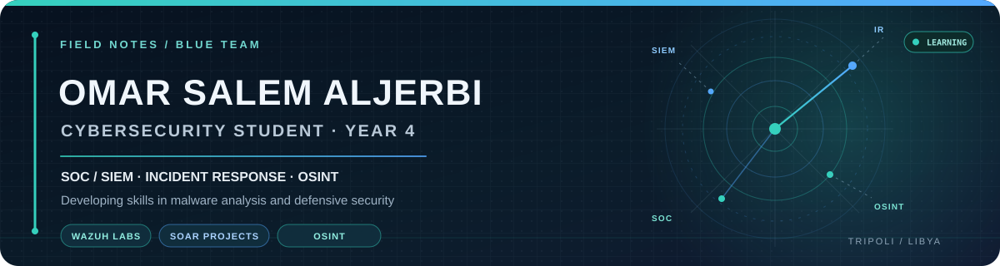

  
  
  

<h3>Defensive Security · SOC / SIEM · Incident Response · Malware Analysis · OSINT</h3>

  I build practical security skills through hands-on labs, SOC simulations, and security-focused software projects.

  <a href="#featured-projects">Projects</a> ·
  <a href="#experience">Experience</a> ·
  <a href="#certifications--training">Certifications</a> ·
  <a href="#current-learning">Current Learning</a>

---

## About Me

I'm a fourth-year Cybersecurity student focused on defensive security and security operations. I'm particularly interested in SOC workflows, SIEM monitoring, incident response, malware analysis, and open-source intelligence.

I have hands-on practice with **Wazuh** through simulated SOC environments and security projects. I enjoy investigating alerts, understanding logs, documenting findings, and building tools that make security workflows easier.

My current direction is **Blue Team / SOC**, while I continue developing my offensive-security fundamentals to better understand how attacks happen and how to detect them.

## Focus Areas

| Area | Current practice and interests |
|---|---|
| **SOC & SIEM** | Wazuh, log monitoring, alert investigation, SOC lab simulations |
| **Incident Response** | Alert triage, response workflows, SOAR concepts, incident documentation |
| **Malware Analysis** | Building foundational static and dynamic analysis skills in isolated labs |
| **OSINT** | Open-source research, information gathering, and source verification |
| **Web Security** | Learning web vulnerabilities and testing methodology through PortSwigger Web Security Academy |

## Featured Projects

<table>
  <tr>
    <td width="50%" valign="top">
      <h3><a href="https://github.com/omar123JR/SAQR">SAQR — Security Automated Quick Response</a></h3>
      <strong>Graduation Project · In Development</strong>
      
A Mini-SOC and incident-response platform designed to detect suspicious endpoint activity, correlate security events, automate deterministic containment, preserve investigation evidence, and generate AI-assisted Arabic incident reports.

      
Wazuh · Sysmon · Docker · Incident Response · AI

    </td>
    <td width="50%" valign="top">
      <h3><a href="https://github.com/omar123JR/soar1">Smart SOAR System</a></h3>
      <strong>Security Automation Project</strong>
      
A lab-based SOAR system built around Wazuh alerts and automated response workflows. The project explores alert processing, playbook orchestration, dashboards, and security notifications.

      
Wazuh · Python · FastAPI · Docker · Streamlit

    </td>
  </tr>
  <tr>
    <td width="50%" valign="top">
      <h3><a href="https://github.com/omar123JR/Hadir">Hadir — Academic Management Platform</a></h3>
      <strong>Full-Stack Software Project</strong>
      
An academic management platform for attendance, grades, schedules, and administrative workflows. The project combines full-stack development with security-aware application design.

      
React · TypeScript · Node.js · MySQL

    </td>
    <td width="50%" valign="top">
      <h3>Wazuh SOC Lab Simulations</h3>
      <strong>Hands-on Security Practice</strong>
      
Practical lab work focused on collecting and reviewing security events, understanding alerts, testing detection scenarios, and learning how SOC monitoring workflows operate.

      
Wazuh · Windows · Linux · Log Analysis

    </td>
  </tr>
</table>

## Experience

### Practical Work Training — General Authority for Information, Libya

**2 months · Approximately 200 training hours**

Completed a practical, work-based training placement in a professional IT environment. This experience added workplace exposure alongside my academic studies and hands-on technical practice.

## Certifications & Training

- **The OSINT Handbook: Mastering Open Source Intelligence** — Packt / Coursera, October 2026. [Verify certificate](https://coursera.org/verify/Z6T5PJSK1K7A)
- **Ethical Hacker** — Cisco Networking Academy, verified course badge.
- **Protect Systems from Penetrations** — Edraak, May 2026.
- **Cyber Security Attack Techniques** — Edraak, May 2026.

## Current Learning

- **PortSwigger Web Security Academy** — Beginning structured web-security practice.
- **eJPT v1 preparation** — Studying through Ahmed Sultan's training.
- **Malware Analysis** — Developing safe lab-based analysis fundamentals.
- **SOC Engineering** — Improving Wazuh monitoring, alert investigation, and incident-response workflows.

## Tools & Technologies

  

  
  
  
  

---

  Learn continuously. Practice safely. Investigate carefully. Build useful security tools.

